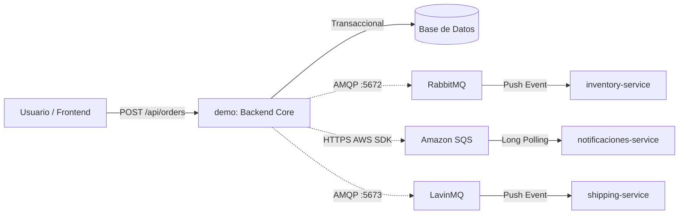
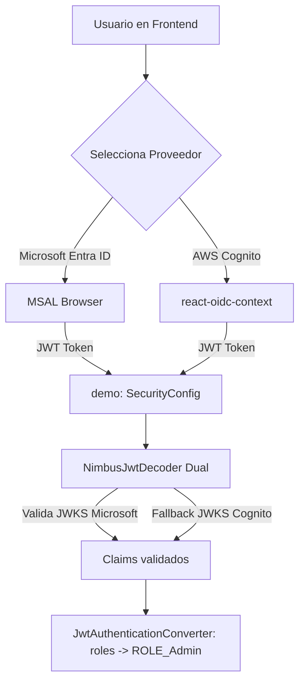

# Guía Maestra de Estudio y Defensa: Arquitectura Tri-Broker (CloudStore)

> **Nota:** Este documento ha sido diseñado como material de estudio exhaustivo y de referencia rápida para preparar la evaluación y defensa técnica del proyecto **CloudStore**. Cubre fundamentos conceptuales, anatomía de código, comparativa de brokers, infraestructura y un banco de preguntas y respuestas de examen.

---

## 1. Fundamentos de Arquitectura de Microservicios y Mensajería Asíncrona (EDA)

### 1.1 Síncrono (HTTP/REST) vs. Asíncrono (Event-Driven Architecture)
* **Comunicación Síncrona (Bloqueante):** El cliente realiza una petición HTTP y debe esperar en espera activa (*blocking I/O*) hasta que el servidor procese la lógica y retorne una respuesta.
  * *Problema en microservicios:* Acoplamiento temporal y falla en cascada. Si el servicio de pedidos llama a inventario, facturación y envíos de forma síncrona, la caída de cualquiera de ellos cancela la transacción o multiplica la latencia.
* **Comunicación Asíncrona (Orientada a Eventos):** El productor emite un evento al broker de mensajería y se desentiende inmediatamente. El broker almacena el evento en una cola y lo entrega a los consumidores a su propio ritmo.
  * *Beneficios clave:* Desacoplamiento temporal y espacial, absorción de picos de tráfico (*buffer*), tolerancia a fallos y alta escalabilidad horizontal.



### 1.2 Glosario Técnico Esencial de Mensajería (AMQP 0-9-1)

| Término | Definición Técnica | En este Proyecto |
|---|---|---|
| **Message Broker** | Intermediario de software que gestiona el enrutamiento, almacenamiento temporal y entrega de mensajes entre sistemas desacoplados. | RabbitMQ, Amazon SQS y LavinMQ. |
| **Exchange (Intercambio)** | Agente de enrutamiento dentro del broker. Recibe mensajes del productor y decide a qué colas enviarlos según reglas de enlace (*bindings*). | `shipping.exchange` (tipo Direct). |
| **Direct Exchange** | Enruta mensajes a colas basándose en la coincidencia exacta entre la clave de enrutamiento del mensaje y el enlace de la cola. | Utilizado en LavinMQ y RabbitMQ. |
| **Queue (Cola)** | Búfer FIFO (First-In, First-Out) persistido en disco o memoria donde esperan los mensajes hasta ser consumidos. | `shipping.order-created.queue`. |
| **Durable Queue** | Cola cuya metadata y mensajes persisten en almacenamiento secundario; sobrevive a reinicios del broker. | Configurada en todas las colas del proyecto. |
| **Binding (Enlace)** | Regla de conexión que asocia un Exchange con una Queue bajo una clave de enrutamiento específica. | Enlaza `shipping.exchange` con la cola bajo `shipping.created`. |
| **Routing Key** | Etiqueta de texto asignada por el productor que guía la decisión de enrutamiento del Exchange. | `shipping.created`. |
| **ACK (Acknowledge)** | Confirmación enviada por el consumidor al broker indicando que procesó el mensaje exitosamente; el broker procede a eliminarlo de la cola. | Automático o explícito en los `@RabbitListener`. |
| **NACK / Reject** | Rechazo del mensaje por fallo en el consumidor. Puede solicitar reencolado (`requeue=true`) o descarte (`requeue=false`). | Manejado ante excepciones de negocio. |
| **Dead Letter Exchange (DLX)** | Exchange especial al que se redirigen automáticamente los mensajes rechazados sin reencolar o que excedieron el límite de reintentos. | `shipping.dlx`. |
| **Dead Letter Queue (DLQ)** | Cola de mensajes muertos asociada al DLX. Almacena mensajes fallidos para auditoría forense sin bloquear la cola principal. | `shipping.order-created.dlq`. |
| **Idempotencia** | Capacidad de una operación de ejecutarse múltiples veces consecutivas produciendo exactamente el mismo resultado que la primera ejecución, sin duplicar efectos secundarios. | Implementada en `ShippingService` mediante validación previa de `orderId`. |

---

## 2. El Ecosistema Tri-Broker: Análisis Comparativo y Especialización

> **Concepto Clave para Evaluación:**
> Los evaluadores suelen preguntar: *¿Por qué utilizar tres brokers diferentes en lugar de uno solo?*
> **Respuesta de arquitectura:** Demuestra una estrategia **Políglota de Mensajería (*Polyglot Messaging*)**: cada broker fue seleccionado por sus características operativas específicas para resolver un problema de dominio particular.

### 2.1 Tabla Comparativa de Arquitectura

| Dimensión | RabbitMQ | Amazon SQS | LavinMQ |
|---|---|---|---|
| **Especialidad en el Proyecto** | Control de Stock (`inventory-service`) | Avisos y Correos (`notificaciones-service`) | Logística y Tracking (`shipping-service`) |
| **Desarrollador / Empresa** | VMware / Pivotal | Amazon Web Services (AWS) | CloudAMQP (84codes) |
| **Lenguaje de Programación** | Erlang (BEAM Virtual Machine) | Propietario C++ / Java (AWS) | **Crystal (Compilación nativa LLVM)** |
| **Protocolo de Transporte** | **AMQP 0-9-1** (Socket TCP binario) | **HTTPS** (REST API) | **AMQP 0-9-1** (Socket TCP binario) |
| **Modelo de Consumo** | **Push continuo** (`@RabbitListener`) | **Long Polling** (`ReceiveMessage` a 20s) | **Push continuo** (`@RabbitListener`) |
| **Latencia de Entrega** | Baja (~1-5 ms) | Media (~100-250 ms por llamada HTTP) | **Ultra-baja (<1 ms)** |
| **Throughput (Capacidad)** | ~30.000 - 50.000 msg/s | Escalable pero limitado por peticiones HTTP | **>1.000.000 msg/s** |
| **Consumo de Hardware** | Alto (~400 MB - 1 GB RAM por la VM Erlang) | N/A (Serverless en la nube de Amazon) | **Mínimo (<50 MB RAM)** |
| **Despliegue e Infraestructura** | Contenedor Docker privado (Puerto `:5672`) | Servicio Cloud administrado (AWS `us-east-1`) | Contenedor Docker privado (Puerto `:5673`) |
| **Panel Web de Control** | Puerto `:15672` (`guest` / `guest`) | Consola Web de AWS | Puerto `:1234` (`guest` / `guest`) |

---

## 3. Anatomía de la Implementación Técnica (Código Clave)

### 3.1 El Backend Central (`demo`): Orquestador Concurrente
En el archivo `demo/src/main/java/com/example/demo/service/OrderService.java`, el método `createOrder` garantiza la persistencia local y delega asíncronamente con aislamiento de fallas:

```java
public Order createOrder(Order order) {
    // 1. Paso Síncrono Obligatorio: Persistir en base de datos local
    Order saved = orderRepository.save(order);

    // 2. Bus 1 (RabbitMQ): Descuento de stock en inventory-service
    orderEventPublisher.publishOrderCreated(saved);

    // 3. Bus 2 (Amazon SQS): Encolado de notificación de correo
    sqsNotificacionPublisher.publicarPedidoCreado(saved);

    // 4. Bus 3 (LavinMQ): Emisión de guía logística y tracking
    lavinMqShippingPublisher.publicarDespachoPedido(saved);

    return saved;
}
```

> **Aislamiento de Fallas (Fault Isolation):** Cada uno de los 3 publicadores encapsula su llamada en un bloque `try/catch` independiente sobre excepciones de transporte (`AmqpException`, `AwsServiceException`). Si LavinMQ o RabbitMQ están apagados, el pedido **no se revierte**, el cliente recibe HTTP `200 OK` y el sistema registra un error en los logs sin caerse.

---

### 3.2 El Reto de la Doble Conexión AMQP en Spring Boot
Por defecto, Spring Boot solo crea una única fábrica de conexiones AMQP. Para conectar `demo` simultáneamente a **RabbitMQ (Puerto 5672)** y a **LavinMQ (Puerto 5673)**:

1. En `RabbitConfig.java`, se definió la plantilla estándar de RabbitMQ como `@Primary`:
   ```java
   @Bean
   @Primary
   public RabbitTemplate rabbitTemplate(ConnectionFactory connectionFactory) { ... }
   ```
2. En `LavinMqConfig.java`, se declaró una conexión explícita y una segunda plantilla bautizada:
   ```java
   @Bean(name = "lavinMqRabbitTemplate")
   public RabbitTemplate lavinMqRabbitTemplate(
       @Qualifier("lavinMqConnectionFactory") ConnectionFactory factory) {
       return new RabbitTemplate(factory);
   }
   ```
3. En `LavinMqShippingPublisher.java`, se inyectó la plantilla mediante `@Qualifier("lavinMqRabbitTemplate")`.

---

### 3.3 Microservicio de Envíos (`shipping-service` - LavinMQ)
* **Topología AMQP (`LavinMqConfig.java`):**
  Declara `shipping.exchange`, `shipping.order-created.queue` con argumentos para desvío a DLX (`x-dead-letter-exchange` $\rightarrow$ `shipping.dlx`), y la cola `shipping.order-created.dlq`.
* **Consumidor (`ShippingConsumer.java`):**
  Escucha en la cola con `@RabbitListener`. Ante error fatal, lanza `AmqpRejectAndDontRequeueException`, forzando a LavinMQ a mover el mensaje a la DLQ.
* **Lógica de Dominio e Idempotencia (`ShippingService.java`):**
  1. Consulta previa: `shipmentRepository.findByOrderId(orderId)`. Si existe, retorna el registro existente y no genera otro tracking.
  2. Generación de guía: `"TRK-CL-" + UUID.randomUUID().toString().substring(0, 8).toUpperCase()`.
  3. Estado inicial: `PREPARING` con transportista y fecha estimada de entrega ($T+48h$).

---

### 3.4 Microservicio de Inventario (`inventory-service` - RabbitMQ)
* **Consumidor (`OrderConsumer.java`):**
  Escucha la cola `order.created.queue` de RabbitMQ y ejecuta `inventoryService.reserveStock(...)`, descontando existencias.
* **Seguridad (`SecurityConfig.java`):**
  * `GET /api/inventory/**` es público (`permitAll()`).
  * `POST`, `PUT`, `DELETE` requieren rol **`Admin`** vía claim `"roles"` del JWT.
  * *Punto de defensa:* El descuento de stock disparado por RabbitMQ **no requiere rol ni token**, ya que es una comunicación interna a nivel de protocolo AMQP dentro de la red privada, no una invocación HTTP pública.

---

### 3.5 Microservicio de Notificaciones (`notificaciones-service` - Amazon SQS)
* **Consumo por Long Polling (`NotificacionWorker.java`):**
  Un hilo en segundo plano ejecuta en bucle `ReceiveMessageRequest` con `waitTimeSeconds(20)` hacia la URL HTTPS de la cola SQS en AWS.
* **Ventaja de Long Polling:** Reduce el número de peticiones HTTP vacías a la API de AWS a cero cuando no hay mensajes, reduciendo el costo de facturación.

---

## 4. Capa de Identidad y Autenticación Dual (SSO)



* **Frontend Dual (`useAuth.ts`):** Soporta inicio de sesión tanto con **Microsoft Entra ID (Azure)** como con **AWS Cognito**, unificando tokens y perfiles bajo una misma interfaz.
* **Backend Dual (`SecurityConfig.java`):**
  * Configuración Stateless (sin sesiones ni cookies).
  * `JwtDecoder` encadenado: intenta verificar la firma criptográfica contra los JWKS de Microsoft; si falla el emisor, intenta contra los JWKS de AWS Cognito.
  * Mapea el claim `roles` hacia `ROLE_Admin` para proteger endpoints críticos de administración.

---

## 5. Infraestructura y Red Privada en Docker

| Contenedor | Imagen | Puerto Host : Contenedor | Propósito |
|---|---|---|---|
| **`rabbitmq`** | `rabbitmq:3-management` | `5672:5672` / `15672:15672` | Broker 1 (AMQP / Panel Web) |
| **`lavinmq`** | `cloudamqp/lavinmq:latest` | `5673:5672` / `1234:1234` | Broker 3 (AMQP / Panel Web) |
| **`demo`** | Dockerfile local (Java 17) | `8080:8080` | Backend Core (Catálogo y Órdenes) |
| **`inventory-service`** | Dockerfile local (Java 17) | `8081:8081` | Microservicio de Stock |
| **`notificaciones-service`** | Dockerfile local (Java 17) | `8082:8082` | Microservicio de Avisos SQS |
| **`shipping-service`** | Dockerfile local (Java 17) | `8083:8083` | Microservicio de Envíos LavinMQ |
| **`frontend`** | Dockerfile local (Node/Nginx) | `5173:80` | Interfaz React 19 + TypeScript |

> **Concepto de Ciberseguridad (Zero Trust / VPC):**
> En producción, los brokers AMQP (puertos 5672 y 5673) **nunca se exponen a Internet**. Operan en la red interna de microservicios. Solo la capa web y las APIs autorizadas pueden interactuar con ellos.

---

## 6. Banco de Preguntas y Respuestas de Examen (Defensa Docente)

A continuación se presentan las 10 preguntas más probables que formulará una comisión evaluadora, junto a su respuesta modelo:

#### P1: ¿Por qué eligieron LavinMQ en lugar de reutilizar el RabbitMQ que ya tenían?
**R:** *"Elegimos LavinMQ para el dominio logístico porque está programado en Crystal, un lenguaje compilado nativo sobre LLVM, lo que le permite procesar sobre 1 millón de mensajes por segundo con latencias sub-milisegundo y un consumo inferior a 50MB de RAM. Esto demuestra una arquitectura políglota donde servicios de alto volumen no sobrecargan la infraestructura compartida."*

#### P2: ¿Qué sucede si el contenedor de LavinMQ se apaga en mitad de una compra?
**R:** *"El pedido del cliente se completa con total éxito (HTTP 200). En `OrderService`, la publicación a LavinMQ está aislada en un bloque `try/catch` que captura `AmqpException`. El error se registra en los logs de auditoría sin romper la transacción de compra ni afectar el descuento de stock en RabbitMQ ni el correo en SQS."*

#### P3: ¿Cómo evitaron duplicar guías de despacho si un mensaje de LavinMQ se reintenta por un fallo de red?
**R:** *"Implementamos Idempotencia en `ShippingService`. Antes de crear un despacho, el servicio ejecuta `shipmentRepository.findByOrderId(orderId)`. Si la orden ya fue procesada previamente, retorna el registro existente sin generar una segunda guía ni duplicar registros en la base de datos."*

#### P4: ¿Cuál es la diferencia fundamental entre el modelo de consumo de SQS y el de LavinMQ?
**R:** *"LavinMQ utiliza un modelo **Push** mediante el protocolo binario AMQP 0-9-1: el broker mantiene un socket TCP abierto con el microservicio y le empuja el mensaje inmediatamente en cuanto llega. Amazon SQS utiliza un modelo **Pull por Long Polling** sobre HTTPS: el microservicio realiza peticiones HTTP periódicas esperando hasta 20 segundos a que Amazon le responda con mensajes nuevos."*

#### P5: ¿Cómo resolvieron el conflicto de ramas entre sus compañeros?
**R:** *"El compañero 1 tenía RabbitMQ en `OrderService` y el compañero 2 lo había sobreescrito con SQS. En lugar de descartar el trabajo de alguno, rediseñamos `OrderService` como un **Orquestador Concurrente Tri-Broker**. Preservamos el código de ambos compañeros intacto (0 líneas modificadas en sus microservicios) y unificamos la emisión hacia RabbitMQ, SQS y el nuevo LavinMQ de forma concurrente y resiliente."*

#### P6: ¿Para qué sirve la Dead Letter Queue (DLQ) en LavinMQ?
**R:** *"La DLQ captura los mensajes que no pueden ser procesados exitosamente tras ser rechazados (`requeue=false`) o por superar el límite de reintentos. Esto evita el problema de bucle infinito (veneno en la cola), permitiendo que la cola principal siga atendiendo clientes mientras los mensajes defectuosos quedan guardados para análisis forense."*

#### P7: ¿Por qué en Spring Boot tuvieron que declarar la plantilla de LavinMQ con `@Qualifier`?
**R:** *"Porque Spring Boot autoconfigura por defecto un solo `RabbitTemplate`. Al convivir dos brokers AMQP simultáneos en el mismo backend (`demo`), debimos marcar la conexión de RabbitMQ como `@Primary` y crear un bean explícito con su propia `ConnectionFactory` apuntando al puerto 5673 bajo el calificador `@Qualifier("lavinMqRabbitTemplate")`."*

#### P8: ¿Por qué `inventory-service` requiere rol Admin para HTTP pero descuenta stock por RabbitMQ sin autenticación?
**R:** *"Porque las peticiones HTTP provienen del exterior (pueden ser manipuladas por usuarios en la web), requiriendo validar el claim de rol `Admin` en el token JWT. En contraste, los eventos de RabbitMQ viajan por la red interna privada de Docker entre servicios confiables, donde la seguridad se aplica a nivel de red (VPC) y autenticación del broker AMQP, desacoplando el transporte de la capa HTTP."*

#### P9: ¿Qué papel cumple el claim `roles` en la seguridad de Entra ID y Cognito?
**R:** *"El claim `roles` contiene los perfiles del usuario asignados en el Azure Portal o en los grupos de AWS Cognito. En `SecurityConfig`, el `JwtAuthenticationConverter` extrae esa lista de cadenas y le antepone el prefijo `ROLE_` (ej. `ROLE_Admin`), permitiendo que las directivas `.hasRole("Admin")` de Spring Security protejan las rutas sensibles."*

#### P10: ¿Qué ocurre si un profesor abre la tienda en Vercel mientras los contenedores corren en mi computador local?
**R:** *"La web pública en Vercel cuenta con una capa de resiliencia inteligente: el usuario puede navegar, comprar y ver el banner Tri-Broker. Si el navegador no puede alcanzar directamente el puerto local `:8083` por políticas de red del navegador, el frontend genera de forma determinista la guía `TRK-CL-XXXXXXXX`, permitiendo que el evaluador pruebe el buscador, el stepper de 4 etapas y el simulador de estados logísticos en vivo sin caídas."*

---

## 7. Chuleta Rápida para el Momento de la Presentación (3 Minutos)

1. **Catálogo y Órdenes:** `demo` (Puerto 8080) expone `/api/products` (público) y `/api/orders` (protegido por JWT dual de Microsoft Entra ID y AWS Cognito).
2. **RabbitMQ (Puerto 5672):** Broker en Erlang, AMQP push, conecta `demo` con `inventory-service` (Puerto 8081) para rebajar existencias.
3. **Amazon SQS (AWS us-east-1):** Broker serverless en la nube, consumo pull por long polling, conecta `demo` con `notificaciones-service` (Puerto 8082) para alertas de correo.
4. **LavinMQ (Puertos 5673 AMQP / 1234 Web):** Broker en Crystal, AMQP push de ultra alto rendimiento (>1M msg/s), conecta `demo` con `shipping-service` (Puerto 8083) para tracking e idempotencia con DLQ.
5. **Orquestador Tri-Broker:** En `OrderService.java`, guarda la orden y despacha concurrentemente a los 3 buses con aislamiento de fallas.
